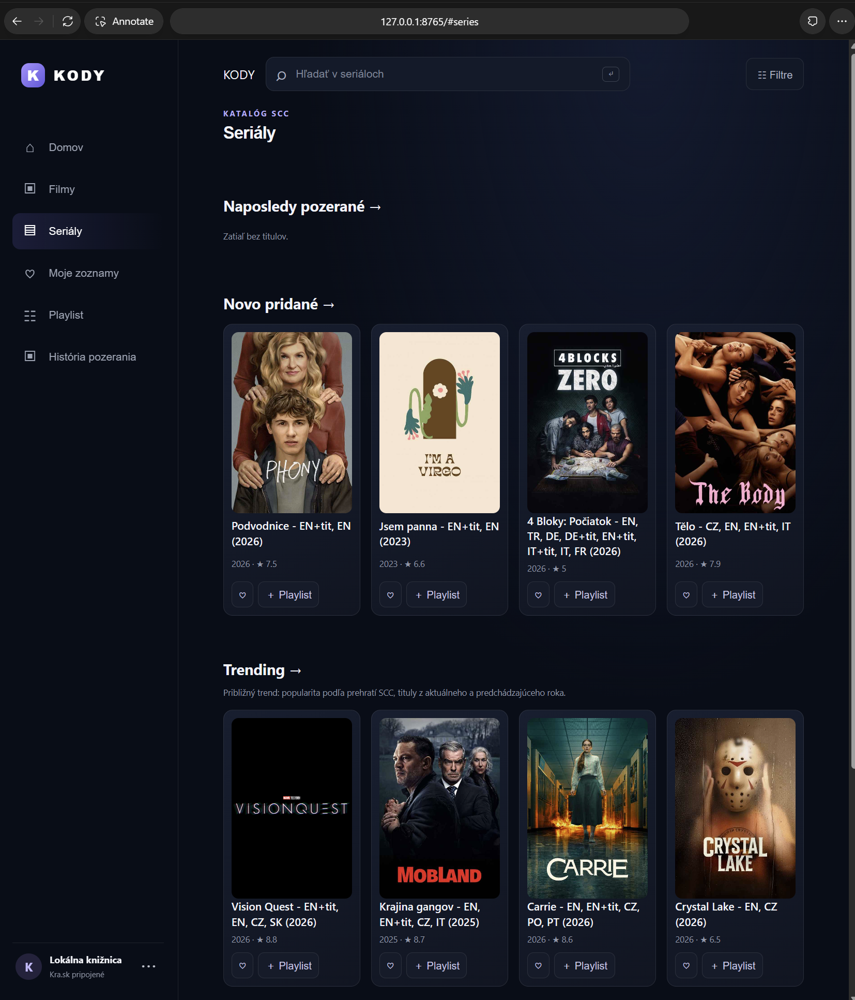

# Kody (SCC)

HTML wrapper originalneho SCC Kody na vyhľadávanie a prehrávanie alebo sťahovanie filmov a súborov.



## Spustenie vo Windows

1. Použi 64-bit CPython **3.11 alebo 3.13**. Pri prvom spustení použije lokálny portable runtime, ak je prítomný; inak vyhľadá systémový Python cez `py` alebo `python`. Neskôr opakovane používa vytvorené `.venv`.
2. Dvojklikni na `start_scc.bat`. Spúšťač vytvorí ignorované virtuálne prostredie `.venv`, nainštaluje balíky z `requirements.txt` a spustí lokálnu aplikáciu. Pri prvom použití je potrebný internet na inštaláciu závislostí.
3. Ak Python nie je nainštalovaný, nainštaluj 64-bit CPython 3.11 alebo 3.13 z python.org. Pribalený helper obsahuje kompatibilné dátové súbory iba pre tieto verzie.

Aplikácia používa pevný lokálny port `8765`. Opakované spustenie otvorí existujúcu inštanciu. Server ukončíš stlačením `Ctrl+C` v okne spúšťača; zavretie prehliadača samo server nezastaví.

## Prihlásenie

Prihlásenie ku kra.sk je potrebné pre získanie stream linkov. Súbor `secrets/creds.txt` je voliteľný: môže obsahovať jeden riadok `meno:heslo` pre automatické prihlásenie. Bez neho zadaj údaje do prihlasovacieho formulára v prehliadači. Po prihlásení sa session uloží lokálne zašifrovaná cez Windows DPAPI.

Aplikácia tiež potrebuje platný token SCC v `secrets/sc.json` (jeden textový token, bez JSON obalu). Tento token nie je súčasťou projektu a treba ho dodať samostatne. Súbory `*.example` sú iba fiktívne vzory a aplikácia ich nečíta.
## Získanie tokenu SCC

Token môžeš získať priamo príkazom PowerShell. Spusti PowerShell v koreňovom priečinku projektu a zadaj:

```powershell
.\get_scc_token.ps1
```

Skript si bezpečne vypýta prihlasovacie meno a heslo ku kra.sk, prihlási sa, použije existujúci záložný token účtu, ak je dostupný, alebo požiada službu o nový. Výslednú hodnotu uloží bez výpisu do `secrets/sc.json`. Ak tento súbor už existuje, skript ho ponechá bez zmeny. Token patrí k tvojmu účtu; neposielaj ho ani ho nepridávaj do GitHubu.

## Funkcie

Aplikácia umožňuje prehliadať a vyhľadávať filmy a seriály. Výsledky môžeš filtrovať a zoraďovať.

V detaile titulu nájdeš epizódy a dostupné streamy. Stream môžeš prehrať vo VLC, stiahnuť alebo skopírovať jeho odkaz.

Obľúbené položky, zoznamy a história sa ukladajú v prehliadači. Playlist umožňuje prehrávať viac titulov za sebou.

Náhľady a obrázky sa ukladajú do lokálnej cache.
